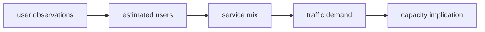

# From demand to design

## Exercise: From activity reports to an NTN demand estimate

Turn a small set of activity reports into an estimate of user density, traffic demand, and a first capacity check. The exercise follows the demand model:

The output of this exercise to build a traceable demand model with assumptions that can be challenged. 

**Recommendation:** Use a spreadsheet to solve this exercises

### Scenario

A satellite operator is considering a service for a **900 km² maritime corridor** where terrestrial coverage is unavailable. AIS reports are aggregated into two equal-duration observation windows. Treat these counts as a proxy for vessels present during each window, not as a count of unique vessels over the whole day.

| Window | AIS reports in corridor |
| --- | ---: |
| Quiet period | 18 |
| Busy period | 42 |

Use the following planning assumptions:

- Each AIS report represents **1.2 people** who could use the service (occupancy factor, $\alpha_o$).
- **75%** of those people are expected to use this satellite service (service penetration, $\alpha_p$).
- The service mix and average simultaneous traffic per active user are:

| Service class $s$ | Active-user share $\alpha_s$ | Traffic per active user $m_s$ |
| --- | ---: | ---: |
| Broadband | 0.25 | 0.60 Mbps |
| Operational voice | 0.70 | 0.08 Mbps |
| Telemetry | 0.90 | 0.01 Mbps |

Shares are applied independently: one person may use more than one class. The traffic figures are average simultaneous downlink rates per active class user. For this exercise, assume all three classes have the same planning time window; ignore uplink, protocol overhead, and geographic variation within the corridor.

For an initial capacity check, use **10 Mbps of usable downlink capacity per beam** and a **25% planning margin**. For a deliberately simple coverage check, use **650 km² per beam**. Round required beams up to whole beams.

### 1. Estimate users and density

For each window, calculate:

- Report people: $N_{people}$
- Active users: $N_{active\ users}$
- Active user density: $\rho$

### 2. Estimate traffic by service class

For each window and service class, calculate the number of class users ($N_s$) and the traffic contribution ($D_s$).

Then calculate total demand ($D$).

Show a table with broadband, voice, and telemetry demand in Mbps and the total. State which service class contributes most and why.

### 3. Check capacity and coverage separately

Compute:

- the beam capacity ($N_{beams,cap}$): the required number of beams based on the service demand (for both the quiet and busy periods)
- the beam coverage ($N_{beams,cov}$): the required number of beams based on the coverage area

Use the larger result as the simple first estimate of beams needed. Is capacity or coverage the larger constraint under these assumptions? Explain why these two checks answer different questions.

### 4. Challenge the model

Choose one assumption to vary (occupancy, penetration, service share, traffic per user, or capacity per beam). Make a reasonable alternative assumption, recalculate the busy-period total demand, and describe what changed in the capacity result.

Record the alternative assumption and the before/after result. Do not silently change multiple inputs at once.

***
### Answer

Baseline calculations

| Window | People $Nr\alpha_o$ | Active users $Nr\alpha_o\alpha_p$ | Density (users/km²) |
| --- | ---: | ---: | ---: |
| Quiet | 21.6 | 16.2 | 0.018 |
| Busy | 50.4 | 37.8 | 0.042 |

Service factors per active user:

- Broadband: $0.25\cdot0.60=0.150$ Mbps
- Operational voice: $0.70\cdot0.08=0.056$ Mbps
- Telemetry: $0.90\cdot0.01=0.009$ Mbps
- Total: $0.215$ Mbps per active user

| Window | Broadband (Mbps) | Voice (Mbps) | Telemetry (Mbps) | Total (Mbps) |
| --- | ---: | ---: | ---: | ---: |
| Quiet | 2.430 | 0.907 | 0.146 | 3.483 |
| Busy | 5.670 | 2.117 | 0.340 | 8.127 |

The busy-period capacity check is $\lceil8.127\cdot1.25/10\rceil=2$ beams. Coverage requires $\lceil900/650\rceil=2$ beams. The simple estimate is therefore **2 beams**; neither check dominates at baseline. Broadband contributes most of the demand.
