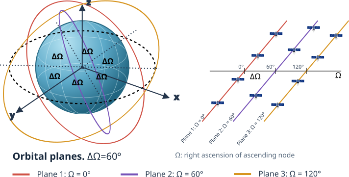

# Network transport

## 1. Satellite constellation and ISL

You need to dimension the satellite constellation based on the ISL maximum latency. Assume a LEO orbit of 500km and a maximum allowed ISL latency of 10 ms. The speed of light is 3e8 m/s and the Earth radius is 6371 km. Assume a perfecty circular orbit (eccentricity $0.0$)

1. If the satellites only have intra-orbital-plane ISL, what is the minimum number of satellites that need to be deployed in an orbital plane?
2. Let's assume the satellites can also have between-plane ISL; what is the minimum number of orbital planes needed?
3. What is the minimum number of satellites needed in total to satisfy the ISL latency requirement?

$$
\pagebreak
$$

### Answer

1. The maximum distance between two satellites in the same plane is determined by the maximum allowed ISL latency.
   1. Orbit radius: $6371 + 500 = 6871\ km$
   2. Maximum distance: $10\ ms * 3e8\ m/s = 3000\ km$
   3. Orbit perimeter: $2 * \pi * 6871\ km \simeq 43172\ km$
   4. Minimum number of satellites in the same plane: $\left\lceil \frac{43172\ km}{3000\ km} \right\rceil = 15$ satellites per plane.
2. The maximum longitude of ascending node between two consecutive orbital planes is determined by the maximum allowed ISL latency.
   1. Maximum distance allowed: $10\ ms * 3e8\ m/s = 3000\ km$
   2.
      1. Minimum number of orbital planes: $n_{min\ orbital\ planes} = \left\lceil \frac{2 \pi 6871\ km}{3000\ km}\right\rceil = 15$.
      2. Maximum longitude of ascending node $\Omega$ between two consecutive orbital planes: $\frac{360^\circ}{15} = 24^\circ$.
   3. Minimum number of total satellites: $15 \times 15 = 225$ satellites.

$$
\pagebreak
$$

## 2. Gateway and ISL routing cost

A network can send traffic over either a **gateway-first** route or an **ISL-assisted** route. Use the values below:

| Route | One-way delay | Available capacity | Deployment-complexity points |
|---|---:|---:|---:|
| Gateway-first | 81 ms | 600 Mbps | 1 |
| ISL-assisted | 22 ms | 150 Mbps | 3 |

For a flow that fits the route's available capacity, calculate its routing cost:

$$
K_{\text{route}} =
0.5\left(\frac{T}{100\text{ ms}}\right)
+ 0.3\left(1-\frac{C_{\text{available}}}{1500\text{ Mbps}}\right)
+ 0.2\left(\frac{D}{3}\right)
$$

Here, $T$ is delay, $C_{\text{available}}$ is available capacity, and $D$ is the deployment-complexity score. Lower cost is better. A route is not feasible if it lacks capacity for the flow. Treat the listed capacities as residual capacity before either flow is assigned.

1. Which route should carry a 100 Mbps voice-and-control flow?
2. Which route should carry a 500 Mbps bulk-transfer flow? Assign the voice-and-control flow first, then account for the capacity it uses.
3. Explain why the route with the lowest delay is not necessarily the best choice for every flow.

$$
\pagebreak
$$

### Answer

1. Both routes can carry the 100 Mbps flow. The gateway-first routing cost is
   $0.5(81/100) + 0.3(1 - 600/1500) + 0.2(1/3) \simeq 0.652$.
   The ISL-assisted cost is
   $0.5(22/100) + 0.3(1 - 150/1500) + 0.2(3/3) = 0.58$.
   Choose the ISL-assisted route. It has the lower cost, and its remaining capacity is $150 - 100 = 50$ Mbps.
2. The ISL-assisted route has only 50 Mbps remaining, so it cannot carry the 500 Mbps bulk flow. The gateway-first route has 600 Mbps available, so it can carry the flow; 100 Mbps remains afterward.
3. The ISL-assisted route has lower delay, but also less available capacity and a higher deployment-complexity score. The best route depends on the flow's capacity requirement as well as the relative importance of delay, capacity, and deployment cost.

$$
\pagebreak
$$

## 3. Traffic aggregation and oversubscription

Three satellite beams send traffic to a gateway over a shared feeder link:

| Beam | Requested traffic |
|---|---:|
| Beam A | 275 Mbps |
| Beam B | 340 Mbps |
| Beam C | 415 Mbps |

The shared feeder link has a capacity of 800 Mbps. Assume all requested traffic occurs simultaneously.

1. Calculate the aggregate requested traffic.
2. Calculate the oversubscription ratio $R_{OS}$ and state whether the link is under-subscribed, fully subscribed, or over-subscribed.
3. How much does requested traffic exceed the feeder link capacity? Can the link carry all three beams' requested traffic at once?
4. Give two possible network actions to handle the excess demand.
5. A nearby satellite can receive rerouted traffic over an ISL and forward it to Gateway B. The ISL route and Gateway B's feeder link each have 250 Mbps of available capacity. Describe the route and calculate how much capacity would remain on the ISL route and Gateway B's feeder link after rerouting the minimum necessary traffic.

$$
\pagebreak
$$

### Answer

1. The aggregate requested traffic is $275 + 340 + 415 = 1030$ Mbps.
2. $R_{OS} = 1030 / 800 = 1.2875$, or approximately $1.29:1$. Since $R_{OS} > 1$, the feeder link is over-subscribed.
3. Requested traffic exceeds capacity by $1030 - 800 = 230$ Mbps, so the link cannot carry all three beams' requested traffic simultaneously.
4. The network could reroute some traffic over another path, shape or prioritize traffic, or increase the feeder-link capacity.
5. Yes. Reroute 230 Mbps from the overloaded feeder path: the satellite sends it over the ISL to the nearby satellite, which forwards it through Gateway B's feeder link. This reduces demand on the original feeder to 800 Mbps. The ISL route and Gateway B's feeder link each have $250 - 230 = 20$ Mbps of capacity remaining.

$$
\pagebreak
$$

## 4. Gateway switch-over and buffering

A LEO satellite sends **200 Mbps** of traffic to a gateway. During a gateway switch-over, the feeder path is unavailable for **0.4 seconds**. The satellite has an initially empty **8 MB** buffer for this traffic.

When the new path becomes available, it can transmit **300 Mbps**, while traffic continues arriving at 200 Mbps. Assume constant rates, no protocol overhead, and that data arriving when the buffer is full is lost. Use **1 MB = 8 million bits**.

1. How much data arrives during the interruption?
2. How much is buffered and how much is lost?
3. Once the new path is available, how long does it take to empty the buffer? Why is the answer not simply the buffer size divided by 300 Mbps?

### Protecting critical traffic

Of the 200 Mbps, **25 Mbps** is critical traffic. Before the interruption, it is redirected to an independent backup path with **40 Mbps** available. It remains on that path throughout recovery. The remaining traffic uses the buffer and the new 300 Mbps path.

4. Recalculate the data lost during the interruption and the buffer-draining time.
5. What assumptions must hold for the critical traffic to experience no loss?

$$
\pagebreak
$$

### Answer

1. $200\ \text{Mbps} \times 0.4\ \text{s} = 80\ \text{Mb} = 10\ \text{MB}$.
2. **8 MB** is buffered and $10 - 8 = 2\ \text{MB}$ is lost.
3. The buffer drains at the net rate of $300 - 200 = 100\ \text{Mbps}$ because new traffic continues to arrive. It takes $64\ \text{Mb} / 100\ \text{Mbps} = 0.64\ \text{s}$ after the new path becomes available.
4. The remaining traffic arrives at 175 Mbps. During the interruption, $175\ \text{Mbps} \times 0.4\ \text{s} = 70\ \text{Mb} = 8.75\ \text{MB}$ arrives, so $8.75 - 8 = 0.75\ \text{MB}$ is lost. The buffer drains at $300 - 175 = 125\ \text{Mbps}$, taking $64\ \text{Mb} / 125\ \text{Mbps} = 0.512\ \text{s}$.
5. The backup must already be active, independent of the unavailable path, and provide at least 25 Mbps throughout the interruption and recovery. The redirection and backup path must not themselves cause packet loss.

$$
\pagebreak
$$

## 5. Graph-based routing cost

Model the satellite network and its connection to a gateway as a weighted graph. Satellites and the gateway are nodes; communication links are edges. Assume links are bidirectional, and the edge costs add along a route. The edge cost represents a combination of delay, congestion, and deployment cost.

Traffic starts at satellite $A$ and must reach gateway $G$. The available links and their costs are:

| Link | Cost |
|---|---:|
| A--B | 2 |
| A--C | 5 |
| B--C | 1 |
| B--D | 4 |
| C--D | 1 |
| C--G | 7 |
| D--G | 3 |

1. Draw the graph and label each edge with its cost.
2. Calculate the total cost of each route: $A$--$C$--$G$, $A$--$B$--$D$--$G$, and $A$--$B$--$C$--$D$--$G$.
3. Which route has the lowest cost?
4. Congestion increases the cost of link C--D from 1 to 5. Recalculate the three route costs and identify the lowest-cost route.

$$
\pagebreak
$$

### Answer

1. The graph has nodes $A$, $B$, $C$, $D$, and $G$, connected by the links in the table.
2. The route costs are:
   1. $A$--$C$--$G$: $5 + 7 = 12$.
   2. $A$--$B$--$D$--$G$: $2 + 4 + 3 = 9$.
   3. $A$--$B$--$C$--$D$--$G$: $2 + 1 + 1 + 3 = 7$.
3. Choose $A$--$B$--$C$--$D$--$G$, with a total cost of 7.
4. With the C--D cost increased to 5, the routes cost 12, 9, and $2 + 1 + 5 + 3 = 11$, respectively. The lowest-cost route is now $A$--$B$--$D$--$G$, with a cost of 9.

